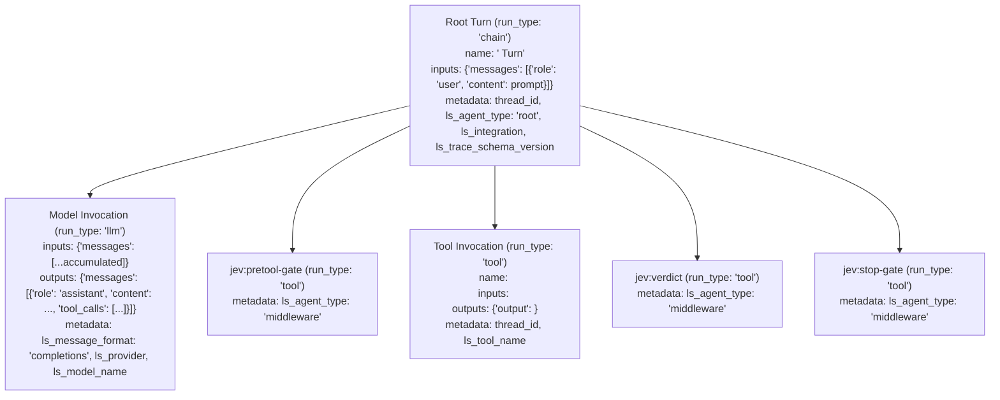

# Design Document: Native LangSmith Tracing for Coding Agent Harnesses

**Date**: 2026-11-11  
**Status**: Ready for Approval  
**Target Path**: `hooks/lib/langsmith_tracer.py`, `hooks/pretool-gate.py`, `hooks/claude-codex-jev-verdict.py`, `hooks/antigravity-jev-verdict.py`, `hooks/stop-gate.py`  
**Test Suite**: `tests/test_langsmith_tracer.py`

---

## 1. Context & Objective
The `jev-cost-guard` plugin provides cost, risk, and verification guardrails across multiple AI coding agent harnesses (Claude Code, OpenAI Codex, OpenCode, Cursor, and Antigravity).

To provide end-to-end observability, turn trajectory debugging, and token governance, the plugin must trace conversation turns, model reasoning, tool executions, and jev's own lifecycle hook decisions (middleware) into **LangSmith**.

This integration strictly complies with:
- The **LangSmith Trajectory View Integrations** contract (`docs.langchain.com/langsmith/trajectory-view-integrations`).
- The **Coding Agent Metadata Contract (`coding-agent-v1`)** (`docs.langchain.com/langsmith/coding-agent-metadata-contract`).

---

## 2. Goals, Non-Goals, and Anti-Goals

### Goals
- **Multi-Harness Native Support**: Transparently trace turns across Claude Code, OpenAI Codex, OpenCode, Cursor, and Antigravity.
- **Trajectory View Fidelity**: Render chat-style turn trajectories in LangSmith (user prompt $\rightarrow$ LLM reasoning/tool calls $\rightarrow$ tool results $\rightarrow$ assistant completion) without "No messages to display" errors.
- **Middleware Visibility**: Record jev's gate decisions (risk check, large output verdict, stop verification) as `ls_agent_type: "middleware"`. These are auditable in the Trace Tree/Details view while automatically omitted from the conversational Trajectory View.
- **Strict Fail-Open Guarantee**: If `langsmith` is not installed or no API key is configured, no-op in $<1\text{ms}$. If any network failure, timeout, or schema error occurs, catch silently and allow the agent's turn to proceed unaffected.
- **Deduplication & State Management**: Maintain session state in `~/.cache/jev/langsmith_state/<session_id>.json` so multiple hook calls in a single turn never double-post spans.

### Non-Goals
- **Replacing Harness Loggers**: The plugin does not replace the harness's native console/UI output or transcript files.
- **Custom Backend Relay**: We use LangSmith's official endpoints directly; no custom tracing proxies are introduced.
- **Mandatory Pip Requirement**: Users who do not install `langsmith` will not be blocked or prompted to install it. Tracing simply remains inert.

### Anti-Goals
- **Never Block a Turn**: A failure to contact LangSmith must never crash a hook or exit non-zero.
- **Never Leak Secrets**: LangSmith API keys must never be logged or echoed in stdout/stderr.

---

## 3. Approaches Considered & Selected

### Option 1: Hook-Distributed Session Ledger & Turn Assembly (Selected)
- **Mechanism**: Spans are recorded into a lightweight session ledger (`~/.cache/jev/langsmith_state/<session_id>.json`) as lifecycle hooks execute.
  - `pretool-gate` captures user prompt (hydrated from transcript when available or hook payload) and pre-tool risk check.
  - `verdict` captures tool outputs and output verdicts.
  - `stop-gate` captures stop gate checks, finalizes the `RunTree`, calls `root_run.post(exclude_child_runs=False)`, and flushes.
- **Why Selected**: Works identically across all agent hosts. Fully adheres to LangSmith's batching and flushing requirements while handling multi-tool sequences cleanly.

### Option 2: Transcript-Driven Ingestion at Turn End
- **Why Rejected**: Only Antigravity and Claude Code write known local transcript files. OpenCode and Cursor hooks communicate via stdin/env and lack standardized transcript file paths.

### Option 3: Independent Unbatched Spans per Hook
- **Why Rejected**: Causes 3–5 HTTP calls per tool turn, introducing noticeable latency to command execution, and risks out-of-order span ingestion in LangSmith.

---

## 4. Detailed Architecture & Design

### 4.1 Dependency & Fail-Open Guard
Before performing any work, `hooks/lib/langsmith_tracer.py` checks:
```python
try:
    import langsmith
    from langsmith.run_trees import RunTree
    from langsmith import Client
except ImportError:
    # Fail-open immediately: langsmith is not installed
    langsmith = None
```
If `langsmith is None`, all public functions in `langsmith_tracer` return immediately (`None`) in $<1\text{ms}$.

### 4.2 Credential & Endpoint Discovery
Credentials are discovered in the following order of precedence:
1. **Environment Variables**:
   - `LANGSMITH_API_KEY` (fallback `LANGCHAIN_API_KEY`)
   - `LANGSMITH_ENDPOINT` (defaults to `https://api.smith.langchain.com`)
   - `LANGSMITH_PROJECT` (fallback `LANGCHAIN_PROJECT` or default `"coding-agents"`)
2. **Global/User Config**:
   - `~/.config/langsmith/config.json` (`api_key`, `endpoint`, `project`)
3. **Harness-Local Configs**:
   - `~/.claude/langsmith.json`
   - `~/.codex/langsmith.json`
   - `~/.opencode/langsmith.json`
4. **Plugin-Local Config**:
   - `config.json` at plugin root

If no API key is found, tracing is deactivated and functions return immediately.

### 4.3 Multi-Harness Detection & Metadata Mapping

#### Session / Thread ID Detection
Inspects hook event payloads and environment:
- Event keys: `conversationId`, `session_id`, `thread_id`, `sessionId`
- ToolCall/transcript payloads: Antigravity envelope `event.get("conversationId")`
- Env vars: `CLAUDE_CONVERSATION_ID`, `CODEX_SESSION_ID`, `OPENCODE_SESSION_ID`, `CURSOR_SESSION_ID`
- Fallback: deterministic hash of working directory + date.

#### Integration Mapping (`ls_integration`)
| Host Indicator | `ls_integration` | `ls_agent_runtime` |
|---|---|---|
| Claude Code (`CLAUDE_PLUGIN_ROOT`, `claude` in path/env) | `"claude-code"` | `"Claude Code"` |
| OpenAI Codex (`CODEX_HOME`, `codex` in path/env) | `"openai-codex"` | `"OpenAI Codex"` |
| OpenCode (`OPENCODE_ZEN_API_KEY`, `opencode` in env) | `"opencode"` | `"OpenCode"` |
| Cursor (`CURSOR_SESSION_ID`, cursor in path) | `"cursor"` | `"Cursor"` |
| Antigravity (`conversationId` + `toolCall`, `AGY_*`) | `"claude-code"` (Trajectory View compatibility fallback) | `"Antigravity"` |
| Fallback / Default | `"claude-code"` | `"Coding Agent"` |

#### Standard Metadata Fields
Every root run includes:
- `ls_trace_schema_version`: `"coding-agent-v1"`
- `ls_agent_purpose`: `"coding"`
- `ls_agent_runtime`: detected runtime string
- `ls_integration`: detected integration string
- `thread_id`: `<session_id>`
- `session_id`: `<session_id>`

---

### 4.4 Trace Hierarchy & Trajectory View Schema



1. **Root Turn (`run_type: "chain"`)**:
   - `name`: `f"{harness_name} Turn"`
   - `inputs`: `{"messages": [{"role": "user", "content": prompt}]}`
   - `extra.metadata`:
     - `thread_id`: `session_id`
     - `session_id`: `session_id`
     - `ls_agent_type`: `"root"`
     - `ls_integration`: `detected_integration`
     - `ls_trace_schema_version`: `"coding-agent-v1"`
     - `ls_agent_purpose`: `"coding"`
     - `ls_agent_runtime`: `detected_runtime`

2. **Model Invocations (`run_type: "llm"`)**:
   - `inputs`: `{"messages": accumulated_messages}`
   - `outputs`: `{"messages": [{"role": "assistant", "content": completion_text, "tool_calls": tool_calls}]}`
   - `extra.metadata`:
     - `ls_message_format`: `"completions"`
     - `ls_provider`: provider name or model name
     - `ls_model_name`: model name

3. **Tool Invocations (`run_type: "tool"`)**:
   - `name`: tool name (e.g. `bash`, `read_file`, `edit_file`)
   - `inputs`: dictionary of arguments
   - `outputs`: `{"output": tool_result_string}`
   - `extra.metadata`:
     - `thread_id`: `session_id`
     - `ls_tool_name`: tool name
   - Also append `{"role": "tool", "tool_call_id": id, "name": name, "content": result}` into the message sequence.

4. **Jev Middleware Invocations (`ls_agent_type: "middleware"`)**:
   - `name`: `"jev:pretool-gate"`, `"jev:verdict"`, `"jev:stop-gate"`
   - `run_type`: `"tool"`
   - `inputs`: gate context (e.g. command, threshold, prompt snippet)
   - `outputs`: decision object (`{"decision": "allow"|"ask"|"deny", "reason": ..., "confidence": ...}`)
   - `extra.metadata`:
     - `thread_id`: `session_id`
     - `ls_agent_type`: `"middleware"`

---

### 4.5 State Tracking, Turn Boundaries, and Lifecycle Ingestion

#### Turn Boundaries & Multi-Tool Disambiguation (Builder Call)
- An active turn is represented in `~/.cache/jev/langsmith_state/<session_id>.json`.
- When `pretool-gate` runs:
  - If no active turn exists in state (or active turn is older than 5 minutes idle), a new `root_run` is initialized.
  - If an active turn already exists, this tool call is recognized as an additional tool invocation within the current multi-tool turn.
- When `stop-gate` runs:
  - The turn's middleware check is recorded.
  - The complete `RunTree` is finalized, posted via `root_run.post(exclude_child_runs=False)`, and `client.flush()` is called.
  - The state file is updated to mark the turn complete (clearing active turn ID).

#### Prompt & LLM Hydration (Builder Call)
- In Claude Code and Antigravity, where local transcript files exist, the tracer uses `hooks/lib/transcript.py` to extract the user's latest prompt, assistant completion text, and model metadata.
- In harnesses without transcript files (OpenCode, Cursor), the tracer uses `event.get("last_user_input")` or synthesized turn context (`f"Turn in {harness_name}"`) and captures the model's tool calls and final assistant output directly from the hook envelopes, ensuring the Trajectory View always has valid message sequences.

#### Flush Safety across Early Exits & Interrupted Turns (Builder Call)
- In `hooks/stop-gate.py`, the tracer finalization is triggered at the top of the hook's execution (or inside a standard `finally` block), ensuring it executes even if `stop-gate` makes an early `skip()` or `allow` decision.
- In `hooks/pretool-gate.py`, if a previous turn remained unfinalized (e.g., due to user interrupt or missing stop hook), the stale turn is automatically finalized and flushed before the new turn begins.

#### Serialization of `RunTree` Across Processes (Builder Call)
- The state ledger persists the `RunTree` dictionary schema (using `root_run.dict()` or compatible JSON structure) with run IDs, inputs, outputs, run types, and metadata.
- When `stop-gate` finalizes, it loads the serialized tree, instantiates the root `RunTree(**state["root_run"])`, attaches all child spans, calls `.post(exclude_child_runs=False)`, and calls `client.flush()`.

---

## 5. Hook Integration Touchpoints

1. **`hooks/pretool-gate.py`**:
   - `tracer = LangSmithTracer.load(session_id, event, env)`
   - `tracer.record_pretool(command=cmd, tool_name=tool, risk_reasons=reasons, decision=dec, confidence=conf)`
2. **`hooks/claude-codex-jev-verdict.py`**:
   - `tracer = LangSmithTracer.load(session_id, event, env)`
   - `tracer.record_posttool(tool_name=tool, tool_input=inp, tool_output=out, verdict=verdict)`
3. **`hooks/antigravity-jev-verdict.py`**:
   - Record Antigravity PreInvocation verdict evaluation as middleware span.
4. **`hooks/stop-gate.py`**:
   - `tracer = LangSmithTracer.load(session_id, event, env)`
   - `tracer.record_stop_and_flush(message=msg, run_facts=facts, decision=dec)`

---

## 6. Testing Plan
- `tests/test_langsmith_tracer.py`:
  1. **Fail-Open when LangSmith Missing**: Verify immediate return ($<1\text{ms}$) with zero exceptions when `langsmith` module is unavailable.
  2. **Fail-Open when API Key Missing**: Verify immediate no-op when credentials are absent.
  3. **Credential Resolution**: Test hierarchy: env > global config > harness config > plugin config.
  4. **Multi-Harness Detection**: Verify correct `ls_integration` and `ls_agent_runtime` across Claude Code, Codex, OpenCode, Cursor, and Antigravity.
  5. **Tree & Metadata Schema**: Verify root `run_type="chain"`, metadata `ls_trace_schema_version="coding-agent-v1"`, and child runs with `ls_agent_type="middleware"`.
  6. **Deduplication**: Verify repeated tool calls do not create duplicate child spans.
  7. **Batch Post & Flush**: Verify `root_run.post(exclude_child_runs=False)` and `client.flush()` are called properly upon turn completion.
